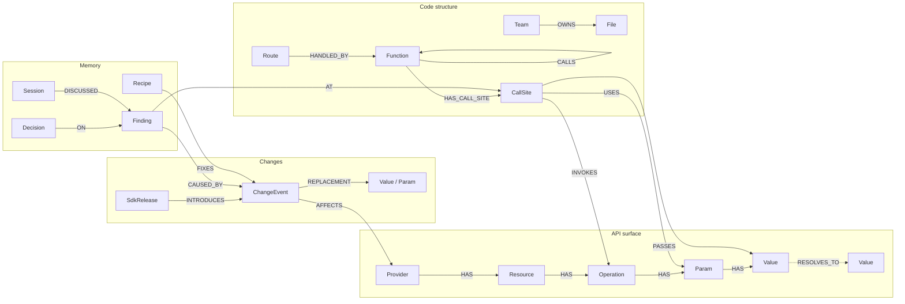

# Avert

Avert knows every external API your code calls, sees when a provider changes one, and traces what it breaks: the call site, the
route, the owning team. It then opens the fix as a pull request.

Some API changes have no version to bump: a retired model id, a sunset API version, a parameter removed on the server. Dependency
bots only read manifests, so they miss these. Avert indexes your code into a [FalkorDB](https://www.falkordb.com) graph, tracks
provider changes from machine-readable sources, and joins the two with one graph query.

- **Docs:** https://avert-five.vercel.app
- **Live demo (read-only path view):** https://avert-demo.fly.dev
- **Hosted MCP endpoint (read-only):** `claude mcp add --transport http avert-demo https://avert-demo.fly.dev/mcp`

## What it finds

A rolling alias, `claude-3-5-sonnet-latest`, resolves to a model retired on 2025-10-28. Nothing in the manifest changed, and no
version could have been bumped. This is real output from the demo service in [`examples/acme`](examples/acme):

```text
$ pnpm avert blast examples/acme lifecycle:anthropic:claude-3-5-sonnet-20241022
1 call sites; routes: POST /support/reply; owners: @acme/support-ai

ChangeEvent retired: claude-3-5-sonnet-20241022 retired on 2025-10-28; replacement claude-sonnet-5-5
            -AFFECTS->
Value       "claude-3-5-sonnet-20241022"
            <-RESOLVES_TO-
Value       "claude-3-5-sonnet-latest" (unpinned alias)
            <-PASSES-
CallSite    msg = claude.messages.create(  (support/app/llm.py:19)
            <-HAS_CALL_SITE-
Function    answer()  (support/app/llm.py:10)
            <-CALLS-
Function    draft_reply()  (support/app/main.py:19)
            <-CALLS-
Function    reply()  (support/app/main.py:15)
            <-HANDLED_BY-
Route       POST /support/reply  (support/app/main.py:14)
            (file support/app/llm.py) <-OWNS-
Team        @acme/support-ai
```

Every result Avert returns carries a path like this, so a finding is never an unexplained claim. The agents open pull requests with
the path as evidence, for example [`avert-demo-acme` #8](https://github.com/daryl-micah/avert-demo-acme/pull/8) for this change.

It also runs on real code. Indexing [`flutter-stripe/flutter_stripe`](https://github.com/flutter-stripe/flutter_stripe) takes
about 3 seconds and finds that stripe-node 23 removed `payment_method_types` from `paymentIntents.create`, which is called at
`example/server/src/index.ts:554` and reached from `POST /payment-sheet`.

## Quickstart

You need Node 22+, pnpm and Docker.

```bash
git clone https://github.com/daryl-micah/avert && cd avert
pnpm install
docker compose up -d                 # FalkorDB on localhost:6380

pnpm avert index examples/acme       # routes, functions, call chains, API call sites
pnpm avert sync examples/acme        # SDK diffs + model lifecycle data -> findings
pnpm avert changes examples/acme     # list change ids
pnpm avert blast examples/acme <change_id>
pnpm avert web                       # path view in the browser
```

Connect a coding agent over MCP (absolute path to your clone):

```bash
claude mcp add avert -e FALKORDB_URL=falkor://localhost:6380 -- npx tsx /abs/path/to/avert/src/cli.ts mcp
```

Avert is not on npm yet, so it runs from a clone. [Cursor, the MCP Inspector and configuration](https://avert-five.vercel.app/connect/)
are in the docs.

## How it works

1. **Index.** Tree-sitter reads Python and TypeScript and writes functions, call chains, routes (Express/Fastify-style, Next.js app
   router, FastAPI, Flask), `CODEOWNERS` teams, and every call to a known provider SDK, resolved to an operation, parameters and
   literal values. Fallback calls (in an `except`/`catch`, or a list of models) are marked as fallbacks.
2. **Detect.** Avert diffs the SDK version your manifest declares against the latest release, for npm (`.d.ts`) and PyPI (wheels).
   It also reads hand-curated model lifecycle data ([`data/lifecycle`](data/lifecycle)), each file dated and linked to its source.
   Only changes to operations your code calls become findings.
3. **Join.** One traversal goes down the API surface from the change to your call sites, through rolling aliases. A second goes up
   the call chain to routes and owners.
4. **Act.** Agents rank findings, group them into batches, and open an issue or a pull request. Nothing is merged automatically.

Launch providers are OpenAI, Anthropic, Google Gemini, Stripe and Twilio. Providers are data, not code: a new one is a few lines in
[`data/providers.yaml`](data/providers.yaml).

## Graph data model

One graph per repository, `avert:<owner>__<repo>`, plus `avert:shared` for published recipes. FalkorDB cannot query across graphs,
so the surface and change nodes a repository needs are merged into its own graph, using ids that are identical everywhere.



A change can attach at any level of the surface (`AFFECTS` on a provider, resource, operation, param or value), and it reaches
every call site beneath it. Every label has an `id` index, with extra indexes on `ChangeEvent.kind`, `Finding.status` and
`Value.value`. The full schema is in the [concepts page](https://avert-five.vercel.app/concepts/).

## The queries

Every Cypher query and graph algorithm call is in [`src/queries.ts`](src/queries.ts), each with its purpose and the tool that uses
it. The [query reference](https://avert-five.vercel.app/reference/queries/) is generated from that file. The ones that carry the
product:

**The join, downward.** From a change, down the surface hierarchy to every leaf, then to the call sites that reach it, including
through a rolling alias:

```cypher
MATCH (c:ChangeEvent {id: $change})-[:AFFECTS]->(s)
MATCH down = (s)-[:HAS*0..4]->(leaf)
MATCH via = (cs:CallSite)-[:INVOKES|USES|PASSES]->()-[:RESOLVES_TO*0..1]->(leaf)
RETURN c, cs.id AS callsite, nodes(down) AS down, relationships(down) AS downEdges, nodes(via) AS via, relationships(via) AS viaEdges
```

**The join, upward.** From a call site, up a call chain of unknown depth to the routes and owners it reaches:

```cypher
MATCH (cs:CallSite {id: $callsite})<-[:HAS_CALL_SITE]-(f:Function)
OPTIONAL MATCH up = (r:Route)-[:HANDLED_BY]->(:Function)-[:CALLS*0..8]->(f)
OPTIONAL MATCH (t:Team)-[:OWNS]->(:File {path: cs.file})
RETURN cs, f, r, up, collect(DISTINCT t.handle) AS owners
```

**Ranking** uses PageRank over the call graph, so a shared helper on many paths outranks a leaf:

```cypher
CALL algo.pageRank('Function', 'CALLS') YIELD node, score
RETURN node.id AS id, score
```

**Batching** connects findings that share an owner and a change or a function with `SAME_FIX` edges, then takes weakly connected
components. One component becomes one issue:

```cypher
CALL algo.WCC({nodeLabels: ['Finding'], relationshipTypes: ['SAME_FIX']}) YIELD node, componentId
WHERE node.status <> 'done'
RETURN componentId, collect(node.id) AS findings
```

**Coordination.** Claiming a finding is one write, and FalkorDB serialises writes per graph, so two agents can never both win:

```cypher
MATCH (f:Finding {id: $id})
WHERE f.status = 'open'
SET f.status = 'claimed', f.claimed_by = $agent, f.claimed_at = $now
RETURN f.id AS id
```

[`scripts/concurrency.ts`](scripts/concurrency.ts) runs several processes against one repo and asserts there are no double claims.

FalkorDB is not optional here: these traversals are the product. With the database stopped, every tool fails.

## MCP tools

Sixteen named domain tools, not a raw Cypher box. The MCP server and the built-in agents use the same registry
([`src/registry.ts`](src/registry.ts)); the [tool reference](https://avert-five.vercel.app/reference/mcp-tools/) is generated from it.

| Area | Tools |
|---|---|
| Index and detect | `index_repo`, `sync_changes`, `list_changes` |
| Trace | `blast_radius`, `list_findings`, `explain_path`, `sdk_params` |
| Prioritise | `rank_findings`, `migration_batches` |
| Coordinate | `claim_finding` |
| Memory | `record_decision`, `recall`, `save_recipe`, `publish_recipe` |
| Act | `open_issue`, `open_pr` |

## Agents and memory

- **Watcher** (`avert watch`) syncs changes, triages with the graph tools, and leaves a note for the migrators.
- **Migrator** (`avert migrate --agent <name>`) claims findings one at a time, recalls earlier decisions, and opens a pull request
  when a replacement or a saved recipe covers the change. Otherwise the model reads the new SDK's parameters, chooses the fix,
  saves it as a recipe, and opens the pull request. A failed run releases its claim.
- Agents never talk to each other. The only handoff is the graph: `open → claimed → done | declined`.
- **Memory** lives in the graph. Decisions (`fix`, `defer`, `wontfix`, `accept_risk`, `note`), a `Session` per client connection, and
  fix recipes that can be published to `avert:shared`. A second MCP client calls `recall` and gets what the first decided; a second
  repository hit by the same change is offered the recipe. Try it with `pnpm tsx scripts/act3.ts examples/acme`.
- **Pull requests are stable.** Branches are named from the change event, `avert/<provider>/<verb>-<subject>`, never the clock.
  Re-running updates the same branch and pull request instead of opening another.

The agents call Groq's OpenAI-compatible API (`GROQ_API_KEY`, model from `AVERT_MODEL`, default `openai/gpt-oss-120b`). Without a
key they fall back to a deterministic path.

## Limits

Avert reports what it can show evidence for. It does not see dynamic dispatch or dependency injection, model ids built at runtime,
wrappers more than one module deep, router libraries beyond the ones listed above, or provider-default changes where your code
leaves a parameter out. Owners come from `CODEOWNERS` team handles only. Model lifecycle data is hand-curated and only as current
as its `retrieved` date. OpenAPI spec diffs and raw HTTP calls made without an SDK are not covered yet. See
[Limits and roadmap](https://avert-five.vercel.app/limits/).

## Development

```bash
pnpm test           # extractor, SDK differ and branch-name suites
pnpm typecheck
pnpm docs:gen       # regenerate the query and tool reference pages from source
```

The repository layout is described in [Contributing](https://avert-five.vercel.app/contributing/), including how to add a provider,
lifecycle data or an extractor rule. The docs site lives in [`site/`](site) (Astro Starlight), and the hosted demo is the same
`avert web` server, deployed with the [`Dockerfile`](Dockerfile) and [`fly.toml`](fly.toml).

## Built with AI assistance

This project was written with [Claude Code](https://claude.com/claude-code) using Claude Sonnet 5.5: the code, tests, queries and docs
were produced in sessions with it, with the design, scope and review decisions made by the maintainer. At run time the built-in
agents use a model hosted on Groq. Commits made with Claude Code carry a `Co-Authored-By` trailer.

## Background

Avert existed earlier as a Postgres prototype, since archived. This repository is a ground-up rewrite on FalkorDB, and no code was
reused from it.

## License

[MIT](LICENSE)
